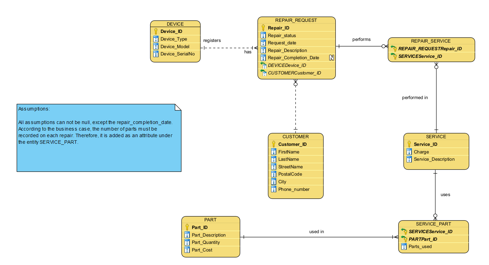

The database records customers, the devices they bring in, each repair request and its status, the services performed on each repair, and the parts those services use.

## Files

Run these in order:

- `create_tables.sql`: drops and creates the seven tables (`CUSTOMER`, `DEVICE`, `REPAIR_REQUEST`, `SERVICE`, `PART`, `REPAIR_SERVICE`, `SERVICE_PART`) with primary keys, foreign keys, `NOT NULL` constraints and `CHECK` constraints on repair status and parts used
- `populate_tables.sql`: inserts sample data into every table
- `queries.sql`: six queries using multi-table joins, `GROUP BY` and aggregate functions, such as customers with the most repairs, most-used services, and parts cost per service

## Database design

`REPAIR_SERVICE` and `SERVICE_PART` are linking tables that resolve the many-to-many relationships between repairs and services, and between services and parts.
